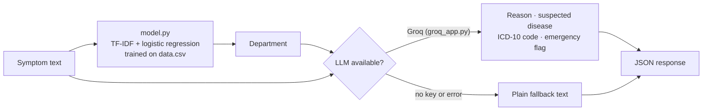

# MedIQ — Backend


The API behind **MedIQ**, an AI medical-navigation web service: type your symptoms and it suggests which department to visit, then helps you find a hospital nearby. This repo is the optional AI server. The web app, screenshots and Kakao Map setup are in [`mediq-front`](https://github.com/mathlete0404-ops/mediq-front).

> MedIQ gives reference information only. It is **not a medical diagnosis**. Please visit a medical facility for an accurate diagnosis and treatment.

## How it works



1. A small scikit-learn classifier picks the **department** from the symptom text.
2. An LLM then writes a short explanation for that department. If the LLM is missing or fails, the server still answers with a fixed fallback sentence, so the app never breaks.

## Two servers, one API

| File | LLM | Extra response fields | When to use it |
|---|---|---|---|
| `groq_app.py` | Groq (`llama-3.3-70b-versatile` by default) | `estimated_disease`, `icd_10_code`, `is_emergency` | **Recommended.** Light, needs only an API key |
| `app.py` | A local Hugging Face model (`beomi/KoAlpaca-Polyglot-5.8B` by default) | none | Offline experiments. Needs `transformers` and `torch`, and a lot of memory |

Both expose the same two routes and allow requests from `http://localhost:3000` (the Next.js dev server).

## Run it

```bash
python -m venv .venv
source .venv/bin/activate
pip install -r requirements.txt

cp .env.example .env          # then put your Groq key in .env
uvicorn groq_app:app --reload # http://127.0.0.1:8000
```

For the Hugging Face version, `pip install transformers torch` and run `uvicorn app:app --reload` instead.

### Settings (`.env`)

| Variable | Used by | Meaning |
|---|---|---|
| `GROQ_API_KEY` | `groq_app.py` | Key from the Groq console. Without it, the server still runs and returns the fallback text |
| `GROQ_MODEL` | `groq_app.py` | Optional. Defaults to `llama-3.3-70b-versatile` |
| `MODEL_NAME` | `app.py` | Optional. Hugging Face model to load |
| `HUGGINGFACE_TOKEN` | `app.py` | Optional. Token for gated models |

`.env` is git-ignored. Never commit a real key.

## API

### `POST /analyze`

```bash
curl -X POST http://127.0.0.1:8000/analyze \
  -H "Content-Type: application/json" \
  -d '{"symptom": "배가 아프고 설사가 나요"}'
```

Shape of the answer from `groq_app.py` (values here are illustrative):

```json
{
  "department": "소화기내과",
  "description": "Short reason for choosing this department",
  "estimated_disease": "Suspected condition",
  "icd_10_code": "A09",
  "is_emergency": false
}
```

| Field | Meaning |
|---|---|
| `department` | Department from the classifier. `null` if none matched, in which case `description` asks for more detail |
| `description` | The LLM's reason, or a fixed fallback sentence |
| `estimated_disease`, `icd_10_code`, `is_emergency` | From the LLM. `null` when the LLM gave no answer |

### `GET /health`

Returns `{"ok": true, "groq_client_loaded": true|false}` (`hf_generator_loaded` for `app.py`), so you can see whether the LLM is reachable.

## Files

```
groq_app.py       FastAPI server using Groq (recommended)
app.py            FastAPI server using a local Hugging Face model
model.py          trains and loads the department classifier
data.csv          training data: symptom text → department (265 rows, 28 departments)
model.pkl         the saved classifier
requirements.txt  Python packages
.env.example      names of the settings to put in .env
```

`model.py` loads `model.pkl` if it exists and trains a new one from `data.csv` if it does not. To retrain on purpose, delete `model.pkl` and send any request, or call `train_model()`.

## Known issues

- **The classifier is weak.** It is a default logistic regression on whitespace-split Korean words, trained on 265 rows. Retrained from `data.csv` it gets about 53% accuracy on its own training data and leans toward the most common label (치과). A quick test with character n-grams and a higher `C` fit the training data fully, but that was not checked on held-out data, so treat it as a lead and not a fix.
- **`model.pkl` is out of date.** The committed file was trained on an older, coarser set of departments and does not match the current `data.csv`. Delete it to retrain from the current data.
- **Not a diagnosis.** The LLM output is a navigation aid and can be wrong.
